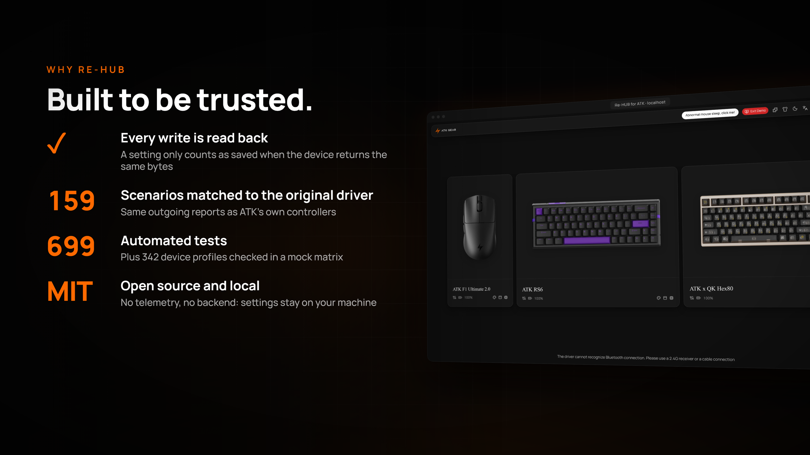

<div align="center">

<a href="https://www.youtube.com/watch?v=ck-0Ct8F_g4" title="Watch the launch film on YouTube"></a>

# Re-HUB for ATK

**The ATK web driver, rebuilt in the open.**<br />
An unofficial, open-source, local-first configurator for ATK mice and keyboards that runs in your browser over WebHID.

[](https://github.com/ScideCodes/ReHUB-for-ATK/actions/workflows/ci.yml)
[](LICENSE)


[](https://github.com/ScideCodes/ReHUB-for-ATK/stargazers)

[**▶ Watch the 36-second film on YouTube**](https://www.youtube.com/watch?v=ck-0Ct8F_g4) · [Quick start](#-quick-start) · [Features](#-features) · [Why Re-HUB](#-why-re-hub) · [Supported devices](#-supported-devices) · [Safety](#-safety-model)

</div>

> [!WARNING]
> **Unofficial and hardware-untested.** Every write path follows the original driver's source and is verified against fake HID devices. None has been run on physical hardware yet. A bad write can leave a device misconfigured, so use it at your own risk. Real-device testers are very welcome: see [Hardware testing](HARDWARE_TEST.md).

## ✨ Why Re-HUB



| | |
|---|---|
| **Every write is read back** | A setting only counts as saved when the device returns the same bytes. There are no acknowledgement-only "success" toasts. |
| **Matched to the original driver** | 159 parity scenarios replay ATK's own controllers and compare the outgoing HID reports byte for byte. |
| **Tested like software should be** | 705 automated tests, plus a mock matrix covering 342 device profiles, an accessibility audit and screenshot checks. |
| **Open source and local** | MIT licensed. No backend, no telemetry, no account: maps and settings stay in your browser's storage. |
| **Safe by construction** | Identity checks, an outgoing-packet allowlist and EEPROM verification are never bypassed. Firmware/DFU commands are permanently blocked and boot endpoints are never offered. |
| **Accessible** | Zero axe violations across 90 page states, in light and dark themes. |

## 🎛 Features

<table>
<tr>
<td width="50%"><br /><b>DPI stages</b>: per-stage values and colours, with X/Y split where the mouse supports it.</td>
<td width="50%"><br /><b>Polling and sensor</b>: 125 Hz to 8K and the sensor sampling modes, offered per model.</td>
</tr>
<tr>
<td width="50%"><br /><b>Button remapping</b>: DPI, config-file, wheel, keyboard and shortcut actions on any button.</td>
<td width="50%"><br /><b>Keyboards</b>: lighting, trigger travel and rapid trigger, key remapping and per-key colour, where the family supports them.</td>
</tr>
</table>

Also included:
- **Offline maps:** edit, duplicate, import and export configurations without a device connected.
- **Demo mode:** try every screen with local mocks; no hardware is touched.
- **Diagnostics:** frame-level HID history, with redacted copy-to-clipboard reports.
- **Message center:** device and settings errors collect behind an unread badge on the bell, with one-click clear.
- **Nine languages:** English, 简体中文, 繁體中文, 한국어, 日本語, Deutsch, Français, Русский and Türkçe, remembered between visits.
- **Interface:** light and dark themes, background wallpapers on every screen, and a colourway picker per device.

## 🚀 Quick start

Requirements: Node.js 20+ and a Chromium-based browser (Chrome, Edge or Brave), because WebHID is Chromium-only.

```bash
git clone https://github.com/ScideCodes/ReHUB-for-ATK.git
cd ReHUB-for-ATK
npm ci
npm run dev
```

Open the printed `localhost` URL. Choose **Add Device** for hardware, or the demo button in the header to explore safely.
Close `atk-hub.exe`, hub.atk.pro and any other configurator first, so the HID collection is free.

| Script | What it does |
|---|---|
| `npm run dev` | Start the dev server |
| `npm run build` / `npm run preview` | Build and serve the static site |
| `npm test` | Unit and integration tests (Vitest) |
| `npm run test:devices` | Mock matrix across every device profile |
| `npm run lint` / `npx tsc --noEmit` | Lint and type-check |
| `npm run shots` | Screenshot regression run (Playwright) |
| `node scripts/audit-browser.mjs` | axe accessibility audit at three widths, in both themes |

## 🖱 Supported devices

The registry covers **320 ATK endpoints** (190 mouse, 130 keyboard). Access is granted per model, based on what the original driver's source proves.

| Tier | Devices | What you get |
|---|---|---|
| **Verified writes** | 8 mouse models on the PAW3950Ultra path (for example ZERO EX, 373B:11CC) and the ATK 68 V2 Pro keyboard (373B:1048) | Full settings, with mandatory readback |
| **Receivers** | 45 dongle endpoints | Writes only after the paired mouse's CID/MID proves a verified model |
| **Opt-in untested writes** | 108 keyboard endpoints (RS7, BITYUAN, HFD, BYKB families) | Source-backed writes, enabled per session after explicit consent |
| **Read-only** | 137 further mouse profiles, ARBITER keyboards | Settings are read; edits stay local |

Details: [mouse access](MOUSE_ACCESS.md) · [keyboard protocol](KEYBOARD_PROTOCOL.md).

## 🛡 Safety model

- **Identity first:** a device must match an exact VID/PID/usage identity (and CID/MID for receivers) before any write path opens.
- **Allowlisted packets:** every outgoing report passes `validateOutgoing` and per-family frame validators. Unknown commands are refused.
- **Readback on every write:** EEPROM and setting writes are compared byte for byte, and a mismatch is reported as a failure.
- **Never dangerous:** firmware update (DFU `0x0D`) is permanently blocked, and boot (`FF02`) endpoints are never offered in the picker.
- **No silent writes:** opening a device, switching maps or importing files never applies unrelated drafts.

## 🧱 Tech stack

Vite · React 19 · TypeScript (strict) · Tailwind · Zustand · Zod 4 · Vitest · Playwright. It's a static site with no server code.

```
src/
  devices/    device registry, layouts, capabilities, parity fixtures
  protocol/   packet codecs, per-family write planners and validators
  hid/        WebHID transport, keyboard/mouse clients, diagnostics
  hub/        the interface (mouse + keyboard workspaces, home, settings)
  features/   maps, device session, shared settings logic
  store/      Zustand stores (maps, keyboard, config)
```

## 🤝 Contributing

Issues and pull requests are welcome, and reports from real hardware are the most valuable. Please read [CONTRIBUTING.md](CONTRIBUTING.md) and report security problems privately as described in [SECURITY.md](SECURITY.md).

## ⚖️ License and disclaimer

The source code is released under the [MIT License](LICENSE).

This project is **not affiliated with, endorsed by or sponsored by ATK**. "ATK" and product names are trademarks of their owners. Product images and videos under `public/` belong to their respective owners and are included only to identify the devices.

## ⭐ Star history

<a href="https://star-history.com/#ScideCodes/ReHUB-for-ATK&Date">
  <picture>
    <source media="(prefers-color-scheme: dark)" srcset="https://api.star-history.com/svg?repos=ScideCodes/ReHUB-for-ATK&type=Date&theme=dark" />
    <source media="(prefers-color-scheme: light)" srcset="https://api.star-history.com/svg?repos=ScideCodes/ReHUB-for-ATK&type=Date" />
    
  </picture>
</a>
