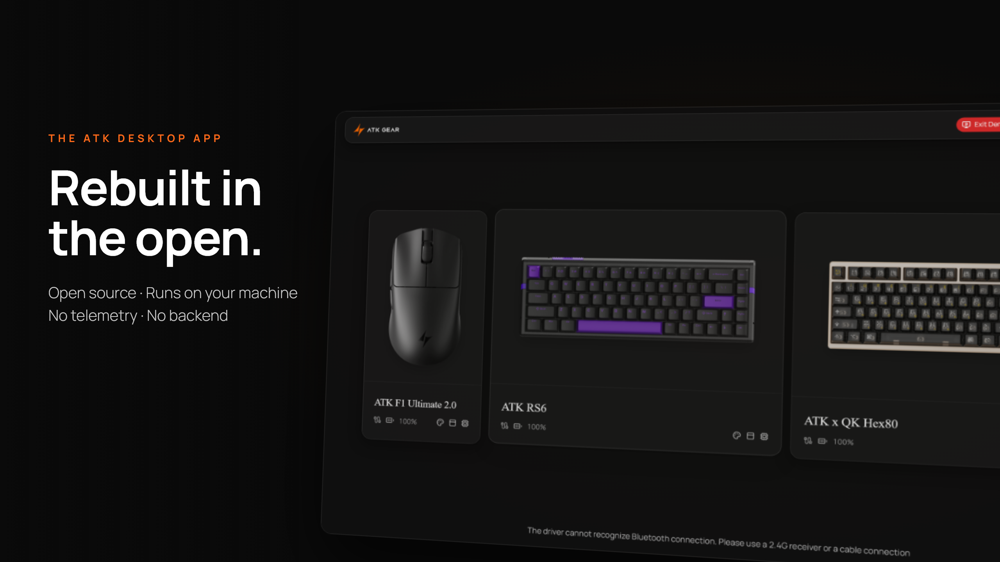
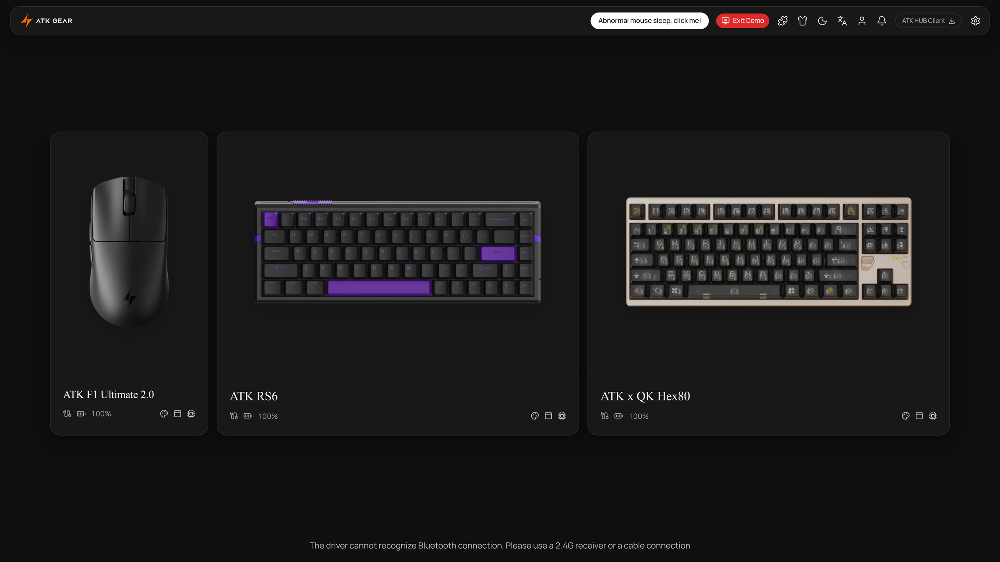
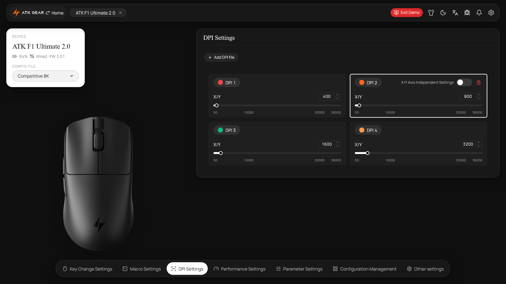
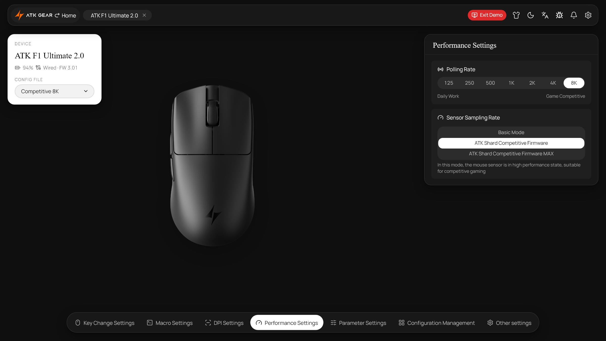
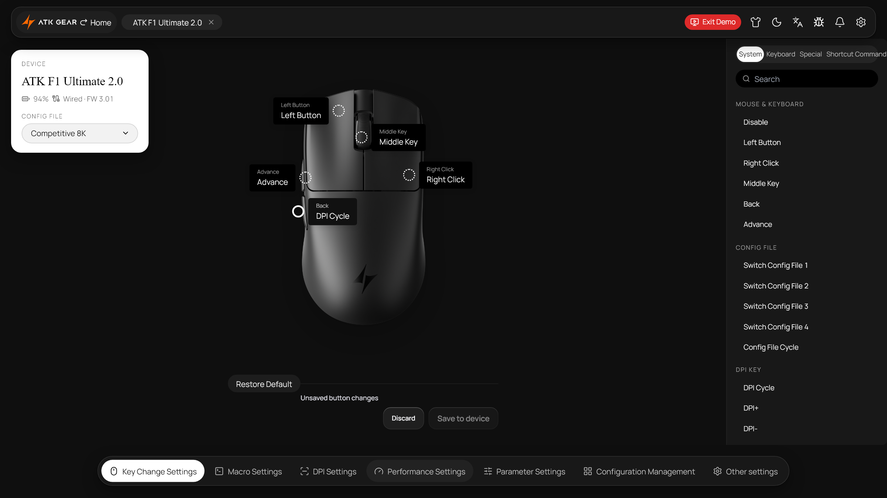
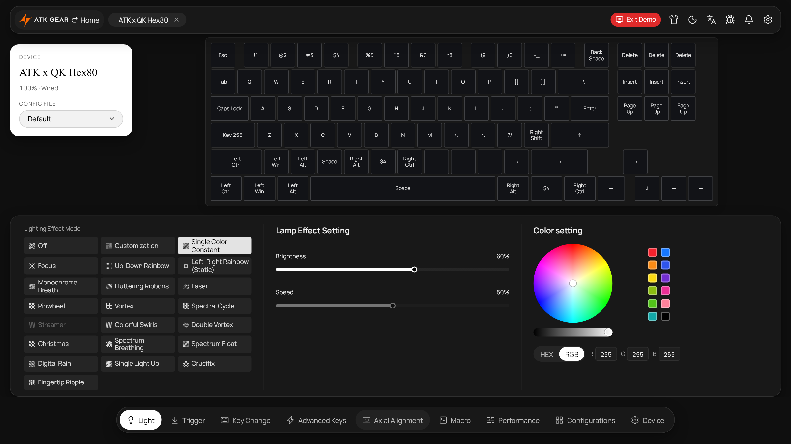

<div align="center">

<a href="https://www.youtube.com/watch?v=ck-0Ct8F_g4" title="Watch the ReHUB showcase on YouTube">
  
</a>

# ReHUB for ATK

**Your ATK setup. Your settings. Open source.**

A local Windows desktop configurator for ATK mice and keyboards.


### [⬇ Download Windows Setup v1.5.8](https://github.com/ScideCodes/ReHUB-for-ATK/releases/download/v1.5.8/ReHUB-Setup-1.5.8-x64.exe)

[▶ Video showcase](#video-showcase) · [Screenshots](#screenshots) · [Features](#features) · [Install](#install) · [Source code](#open-source) · [Changelog](CHANGELOG.md)

</div>

---

ReHUB brings mouse and keyboard configuration into one desktop app — device-specific controls, local profiles, diagnostics, and a demo mode for exploring the interface without hardware. Install once, launch from the Start menu. No Node.js, terminal, browser, or local server required.

---

## Video showcase

<div align="center">

<a href="https://www.youtube.com/watch?v=ck-0Ct8F_g4" title="Watch the ReHUB for ATK showcase on YouTube">
  
</a>

**[▶ Watch the 36-second showcase on YouTube](https://www.youtube.com/watch?v=ck-0Ct8F_g4)**

*The launch film walks through the interface, mouse controls, and keyboard workspace.*

</div>

---

## Screenshots

<div align="center">

<a href="https://raw.githubusercontent.com/ScideCodes/ReHUB-for-ATK/main/docs/media/home.png">
  
</a>

*Device dashboard — pick your hardware and jump straight into configuration.*

</div>

<br />

<table>
  <tr>
    <td width="50%" valign="top">
      <a href="https://raw.githubusercontent.com/ScideCodes/ReHUB-for-ATK/main/docs/media/dpi-1.png">
        
      </a>
      <br /><b>DPI stages</b><br />Per-stage sensitivity and colors, with independent X/Y values where the device supports it.
    </td>
    <td width="50%" valign="top">
      <a href="https://raw.githubusercontent.com/ScideCodes/ReHUB-for-ATK/main/docs/media/poll-8K.png">
        
      </a>
      <br /><b>Polling and sensor</b><br />Polling rates up to 8K and sensor firmware options for the ATK F1 device family.
    </td>
  </tr>
  <tr>
    <td width="50%" valign="top">
      <a href="https://raw.githubusercontent.com/ScideCodes/ReHUB-for-ATK/main/docs/media/keys-assigned.png">
        
      </a>
      <br /><b>Button assignments</b><br />Mouse actions, keyboard shortcuts, DPI cycling, and config switching per button.
    </td>
    <td width="50%" valign="top">
      <a href="https://raw.githubusercontent.com/ScideCodes/ReHUB-for-ATK/main/docs/media/kb-light.png">
        
      </a>
      <br /><b>Keyboard workspace</b><br />Lighting effects, key remapping, trigger travel, rapid trigger, and per-key RGB where supported.
    </td>
  </tr>
</table>

<sub>Click any screenshot to view at full size. Images show the interface in demo mode — available controls depend on the connected device.</sub>

---

## Features

| | What ReHUB provides |
| --- | --- |
| 🖱 **Mouse configuration** | DPI stages, polling, sensor settings, button assignments, and power options where supported. |
| ⌨ **Keyboard configuration** | Lighting, remapping, trigger travel, and rapid trigger for supported device families. |
| 💾 **Local profiles** | Edit, duplicate, import, and export configurations entirely on your computer. |
| 🖥 **Desktop controls** | Device picker, close-to-tray, launch-at-login, and a top-bar button that installs new releases after you confirm. |
| 🔍 **Diagnostics and demo mode** | Inspect redacted device diagnostics or explore the full interface without hardware. |
| 🎨 **Appearance** | Light and dark themes, custom backgrounds, device colors, and nine interface languages. |
| 📋 **Community reports** | Review device identifiers and descriptor metadata before sharing a support report. |

---

## Device support and verification

Support is granted per device family and identity. Some models support verified writes, some require explicit consent for untested writes, and others remain read-only or demo-only. Firmware flashing and bootloader interfaces are blocked.

The 1.5.8 release passed **742 application tests**, **342 mock device scenarios**, and **12 desktop tests**, including compiled installer safety fixtures. Automated checks do not certify physical hardware behavior.

→ [Review record](https://github.com/ScideCodes/ReHUB-for-ATK/blob/desktop-source/docs/audit-1.5.1.md) · [Mouse access notes](https://github.com/ScideCodes/ReHUB-for-ATK/blob/desktop-source/MOUSE_ACCESS.md) · [Hardware checklist](https://github.com/ScideCodes/ReHUB-for-ATK/blob/desktop-source/HARDWARE_TEST.md)

---

## Install

1. **[Download ReHUB Setup 1.5.8 for Windows x64](https://github.com/ScideCodes/ReHUB-for-ATK/releases/download/v1.5.8/ReHUB-Setup-1.5.8-x64.exe)**
2. Run Setup and choose **Install / update ReHUB for ATK**.
3. Open ReHUB, close other configurators using the device, and select your device in the picker.

The installer is currently unsigned. Always download from this repository's [Releases](https://github.com/ScideCodes/ReHUB-for-ATK/releases/latest) and verify the checksum against the accompanying `SHA256SUMS.txt`:

```powershell
Get-FileHash -Algorithm SHA256 .\ReHUB-Setup-1.5.8-x64.exe
```

**Updates:** when a new release is out, a green button appears in the top bar. Confirm, and ReHUB downloads the checksum-verified update, installs it silently and reopens (the automatic check can be turned off in Settings). From 1.5.6 or older, install the latest Setup manually once.  
**Uninstall:** run Setup → **Uninstall**, or use Windows **Settings → Apps → Installed apps**. Saved profiles and settings are kept by default; exported files are outside desktop cleanup.

---

## Open source

ReHUB is MIT licensed. The complete application source, tests, and packaging configuration are public on the [`desktop-source`](https://github.com/ScideCodes/ReHUB-for-ATK/tree/desktop-source) branch. Each release includes a matching source archive alongside the Windows installer.

[Browse the source](https://github.com/ScideCodes/ReHUB-for-ATK/tree/desktop-source) · [Build instructions](https://github.com/ScideCodes/ReHUB-for-ATK/tree/desktop-source#build-and-test) · [Contributing](CONTRIBUTING.md) · [Changelog](CHANGELOG.md)

---

## Support

Use **Help support my device** inside ReHUB to prepare a community report. Review its contents before downloading it or opening a public issue draft. No device commands are sent, and nothing is submitted automatically.

- [Report a ReHUB issue](https://github.com/ScideCodes/ReHUB-for-ATK/issues)
- [Official ATK Help Center](https://www.atk.store/pages/contact/?ref=xStore) for product and order support
- [Security policy](SECURITY.md) for private vulnerability reports

---

## Star history

<div align="center">

<a href="https://star-history.com/#scidecodes/rehub-for-atk&Date">
  <picture>
    <source media="(prefers-color-scheme: dark)" srcset="https://api.star-history.com/svg?repos=scidecodes/rehub-for-atk&type=Date&theme=dark" />
    <source media="(prefers-color-scheme: light)" srcset="https://api.star-history.com/svg?repos=scidecodes/rehub-for-atk&type=Date" />
    
  </picture>
</a>

</div>

---

## License and affiliation

Source code is released under [MIT](LICENSE); bundled dependencies retain their own licenses. ReHUB is an independent community project and is not affiliated with or endorsed by ATK. Product names and artwork belong to their respective owners.
